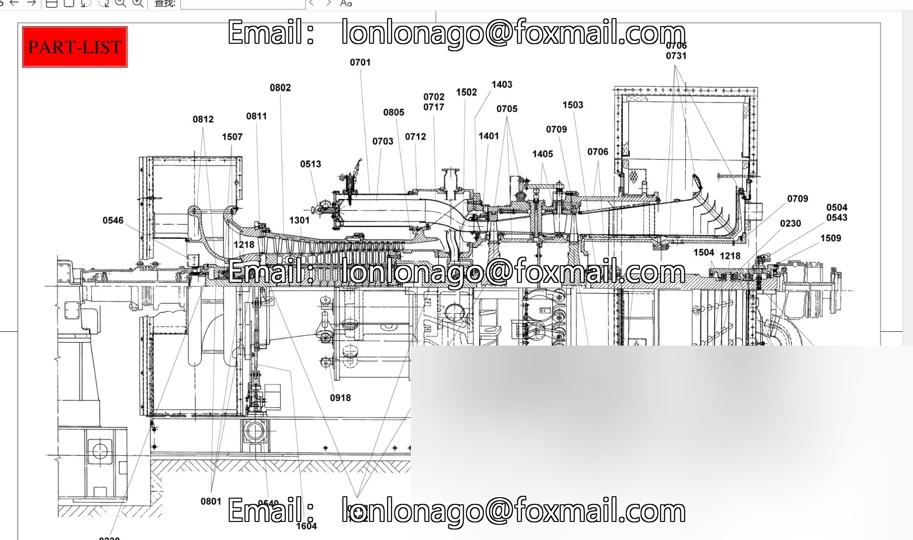
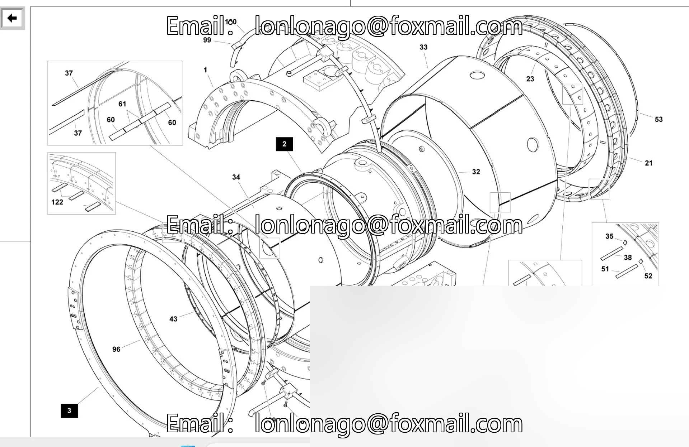
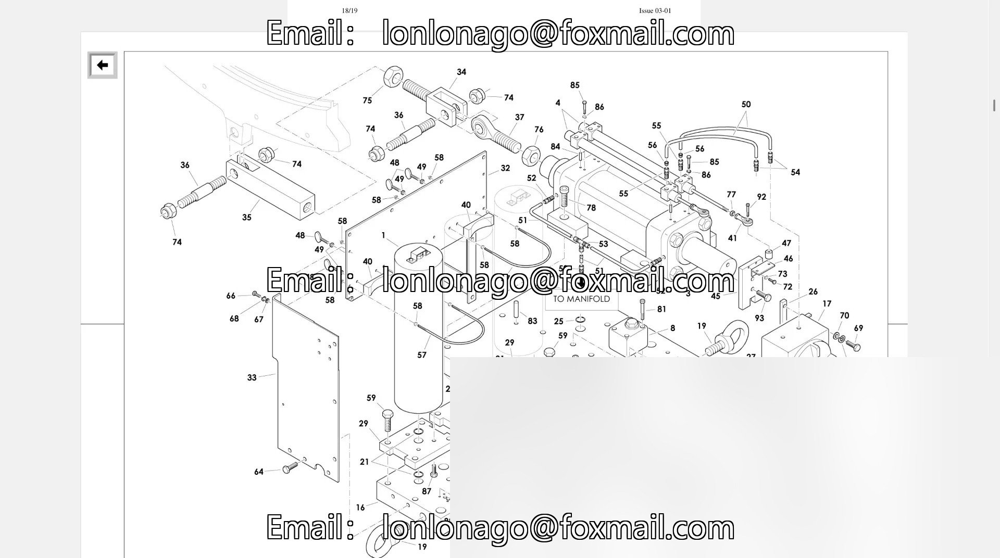
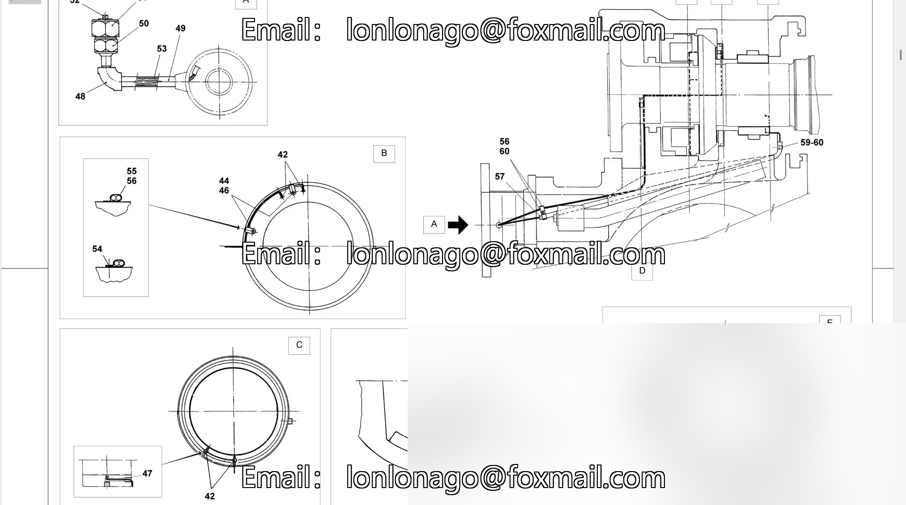

# General Electric Gas Oil New Bijiong - MS 5002C Gas Turbine - Figure

## Body

General Electric Oil & Gas New Birolong - MS 5002C type gas turbine - Figured part breakdown manual, 240-page PDF .
MS 5002C gas turbine is a classic industrial heavy gas turbine produced by US General Electric (GE) under the Nuovo Pignone (currently part of GE Oil & Gas Group).
are non-returnable on sale.

The illustrated part breakdown manual is a 240-page PDF covering part lists and page references.

<!-- AI_ENRICHED -->

## Images

## Payment

Here is a pay link on Stripe ( https://buy.stripe.com/3cs8yP7sY87d0vu9AB ). Please contact me lonlonago@foxmail.com after funding $89, and I will send you a complete data files , thank you!

